<!--
  README for a GitHub PROFILE (repo name must equal your GitHub username).
  Everything on this page is a full-width image from the repo root, so all edges line up.
  To change text or colors, edit the .svg files (text is plain, near the top of each file).
  Own banner: replace hero.svg with your image and keep the same file name,
  or change the hero path below. Best size: 900 x 352 px (or 1800 x 704 for sharpness).
-->





<a href="https://mycitybiz.co.uk/builtspaces/"></a><a href="https://www.traavu.com/"></a><a href="https://alpacaindex.org/"></a>
<a href="https://checkmyphc.org/"></a><a href="https://myphcnavigator.com/"></a>
<a href="https://www.africadatahub.org/dashboards/vaccine-tracker"></a>



